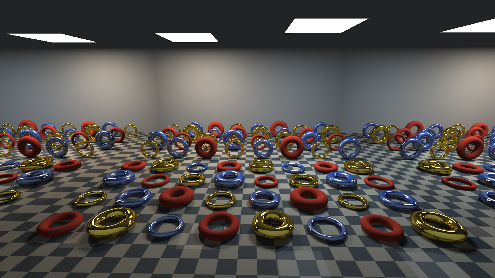
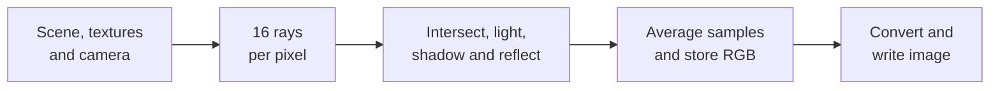
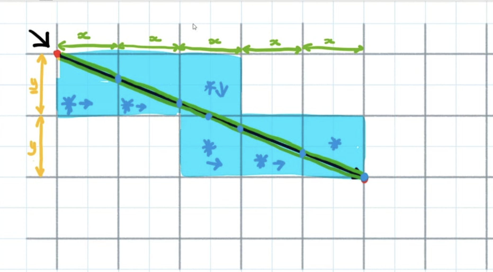
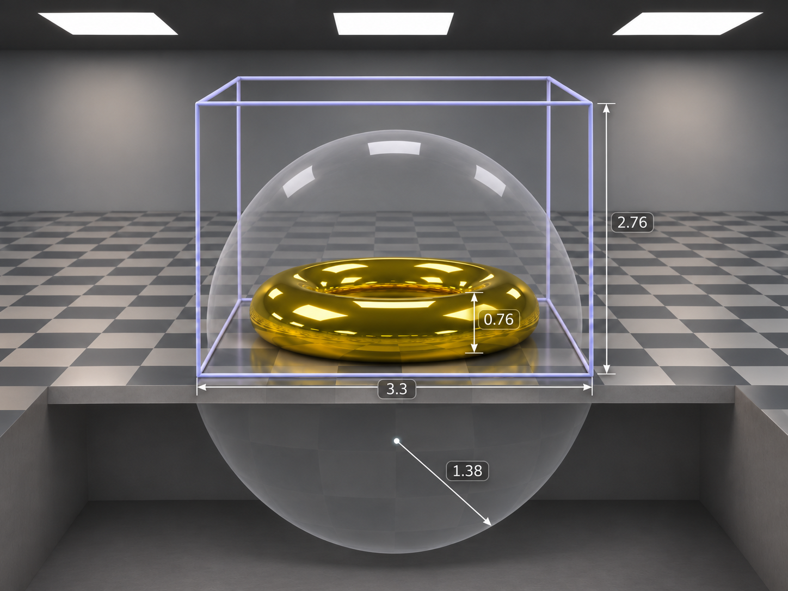
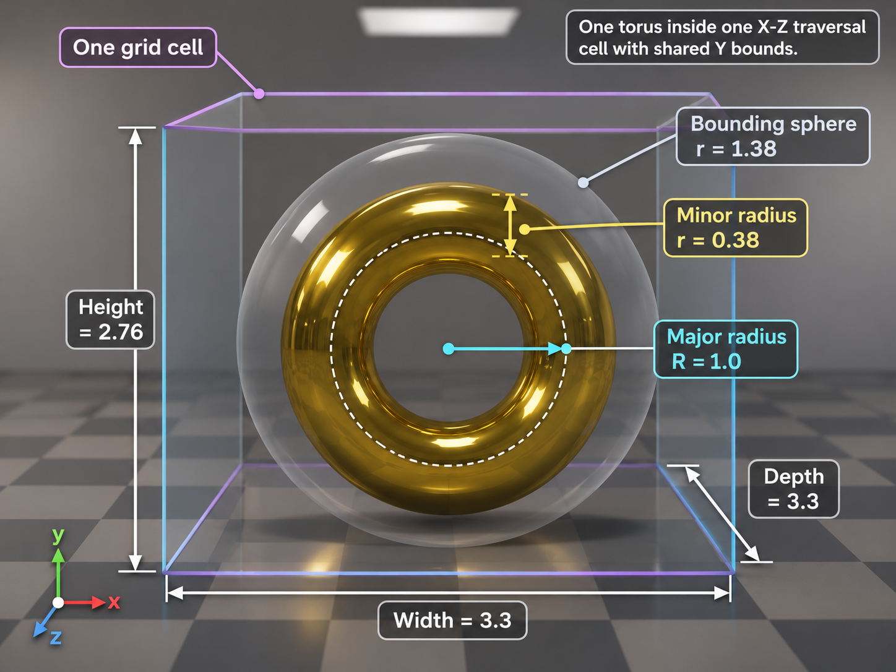
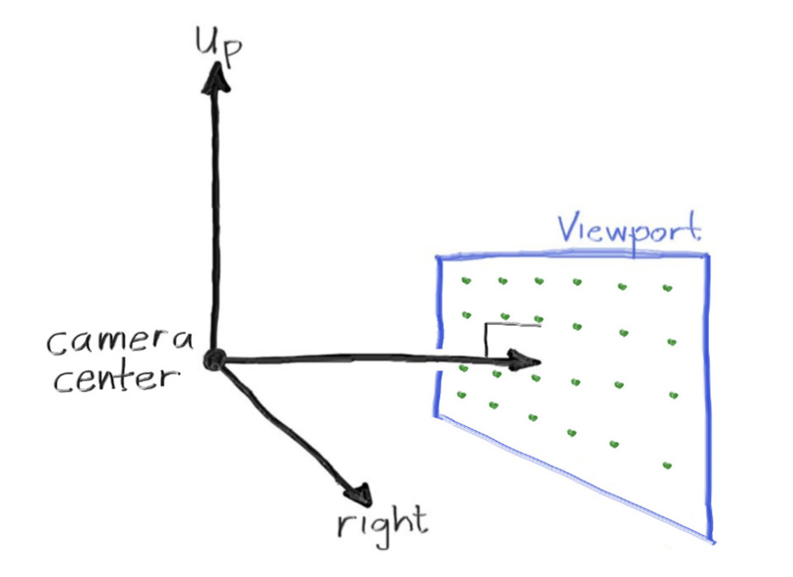
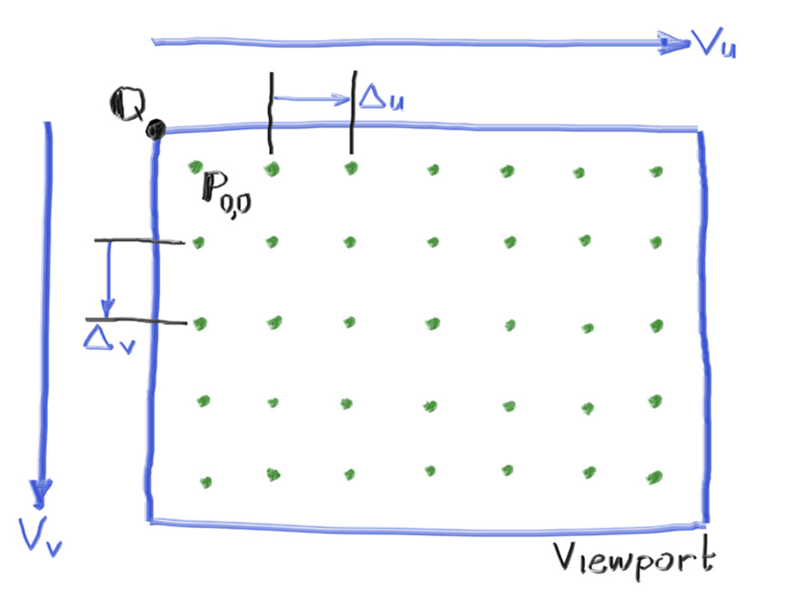
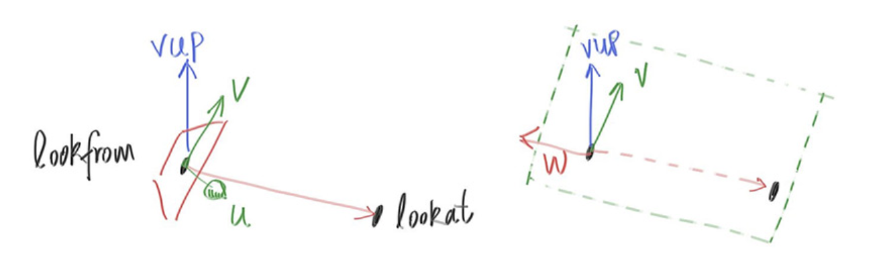

# Tori Ray-Tracer

Serial C++ and CUDA renderers for a fixed scene of 64 tori, built to measure GPU optimizations.

  

## Build and run

| Renderer | Build | Run |
|---|---|---|
| Serial CPU | `make cpu` | `./bin/raytracer_cpu` |
| CUDA GPU | `make gpu` | `./bin/raytracer_gpu` |

On Aqua, submit `qsub job_cpu.sh` or `qsub job_gpu.sh` from the repository root.

## Measured progression

640 × 360, 64 tori, 16 camera samples, two lights × eight samples, three reflections.

| GPU stage | Threads/pixel | Threads/block | Render (ms) | Registers/thread | Profile instructions (billions) |
|---|---:|---:|---:|---:|---:|
| FP64 baseline | 1 | 256 | — | 186 | — |
| FP32 baseline | 1 | 256 | 347.115 | 109 | 29.411 |
| Block tuning | 1 | 32 | 312.647 | 109 | 29.411 |
| Precomputation + parallel samples | 16 | 32 | 223.044 | 113 | 21.084 |
| Uniform grid | 16 | 32 | 56.858 | 119 | 5.143 |
| Scalar quartic roots | 16 | 32 | 55.563 | 115 | — |
| Shuffle trial, rejected | 16 | 32 | 56.689 | 115 | 5.152 |
| Height clipping + ray caching | 16 | 32 | 47.915 | 123 | 3.174 |
| Final block tuning | 16 | 64 | **36.857** | 123 | 3.174 |
| Final block tuning | 16 | 128 | 38.414 | 123 | 3.174 |
| Final block tuning | 16 | 256 | 42.309 | — | — |
| Final block tuning | 16 | 512 | 51.339 | — | — |

## Rendering flow

## Grid traversal

Amanatides–Woo visits cells in ray order. Each visited cell contributes one torus intersection test.

  
   
  Advance through the earliest X or Z boundary, then update that crossing time.

Each torus fits a 3.3 × 3.3 X–Z cell. All rows share the scene's Y clipping bounds.

<table>
  <tr>
    <th width="50%">Flat torus</th>
    <th width="50%">Upright torus</th>
  </tr>
  <tr>
    <td align="center">
      
    </td>
    <td align="center">
      
    </td>
  </tr>
  <tr>
    <td align="center">Example torus height: 0.76.</td>
    <td align="center">Example torus height: 2.76.</td>
  </tr>
</table>

Click an illustration to read its dimensions at full size.

## Camera

The camera basis defines the viewport; pixel steps and sample offsets place the rays within it.

View camera diagrams

<table>
  <tr>
    <th width="50%">Camera and viewport</th>
    <th width="50%">Pixel centres and steps</th>
  </tr>
  <tr>
    <td align="center">
      
    </td>
    <td align="center">
      
    </td>
  </tr>
  <tr>
    <th colspan="2">Camera basis</th>
  </tr>
  <tr>
    <td colspan="2" align="center">
      
    </td>
  </tr>
</table>

## Optimization log

Render times below use CUDA events outside Nsight; instruction counts come from profiles.

### 1. Shared CPU and CUDA baseline

Kept the camera, intersections and shading maths shared between both renderers.
The CPU runs pixels serially; the first GPU version assigned one thread to each pixel.
This gave us a common starting point before changing precision or parallel mapping.

### 2. FP64 → FP32

Nsight showed the FP64 pipeline at about 87.5% utilization, with 186 registers per thread.
Moving geometry to FP32 reduced that to 109 registers and recorded a 347.115 ms render.

### 3. Initial block tuning

Tested block sizes while keeping one thread per pixel and the same rendering work.
The best recorded choice was 32 threads: 312.647 ms versus 347.115 ms at 256 threads.
Instruction counts stayed at 29.411 billion; this changed scheduling, not the amount of ray-tracing work.

### 4. Precomputation and parallel samples

Moved fixed light samples, material shininess and geometry terms out of repeated rendering calculations.
Assigned 16 threads to a pixel's 16 camera samples, then averaged their colours through shared memory.
Together these changes recorded 223.044 ms and reduced profiled instructions to 21.084 billion.

### 5. Uniform-grid traversal

Replaced the full torus scan with Amanatides–Woo traversal of the fixed X–Z grid.
Rays test tori only in crossed cells, with early rejection from the bounding volume.
**Largest recorded algorithmic gain:** 223.044 → 56.858 ms; instructions fell to 5.143 billion.

### 6. Scalar quartic roots

Replaced the **dynamically** indexed root array with four scalar values while keeping the intersection method.
The compiler reported 115 registers per thread, down from 119 for the grid version.
Rendering recorded 55.563 ms. 
### 7. Warp-shuffle trial — rejected

Tried SIMD warp shuffles in place of the shared-memory sample reduction.
The trial recorded 56.689 ms, with no useful improvement over the roughly 56 ms result.
**Kept shared memory:** fewer explicit memory operations did not produce a worthwhile measured gain.

### 8. Height clipping

Clipped grid traversal to the vertical bounds occupied by the tori.
This rejects rays outside that height range and stops traversal beyond it.
Measured together with ray caching, the result was 47.915 ms and 3.174 billion instructions.

### 9. Ray-direction caching

Reused direction length, inverse length and normalized direction across torus tests for the same ray orientation.
Refreshed these measurements only when traversal reaches a row with a different torus orientation.
This removes repeated calculations; its timing contribution is included in the height-clipping result above.

### 10. Final block tuning

Retested block sizes after grid traversal and caching, still using 16 threads per pixel.
Recorded 36.857 ms at 64 threads, 38.414 ms at 128, 42.309 ms at 256 and 51.339 ms at 512.
**64 threads was the fastest recorded setting;** repeat matched runs before treating differences across sessions as a guaranteed gain.

## External references

Background reading for the algorithms and tools used in this project.

| Topic | Reference |
|---|---|
| Camera, rays and anti-aliasing | [Ray Tracing in One Weekend](https://raytracing.github.io/books/RayTracingInOneWeekend.html) |
| Torus equations and normals | [Ray–torus intersection: Ray Tracing News archive](https://steve.hollasch.net/cgindex/render/raytorus.html) |
| Cubic and quartic roots | [Graphics Gems: Jochen Schwarze's Roots3And4.c](https://github.com/erich666/GraphicsGems/blob/master/gems/Roots3And4.c) |
| Uniform-grid traversal | [Amanatides & Woo: A Fast Voxel Traversal Algorithm for Ray Tracing (1987)](https://doi.org/10.2312/egtp.19871000) |
| DDA visual explanation | [javidx9: Super Fast Ray Casting in Tiled Worlds using DDA](https://www.youtube.com/watch?v=NbSee-XM7WA) |
| CUDA optimization | [NVIDIA CUDA C++ Best Practices Guide](https://docs.nvidia.com/cuda/cuda-c-best-practices-guide/index.html) |
| Profiling and metric interpretation | [NVIDIA Nsight Compute Profiling Guide](https://docs.nvidia.com/nsight-compute/ProfilingGuide/index.html) |
