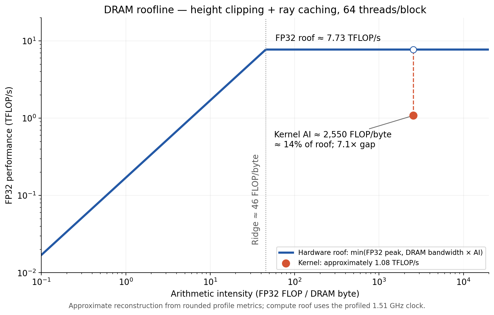
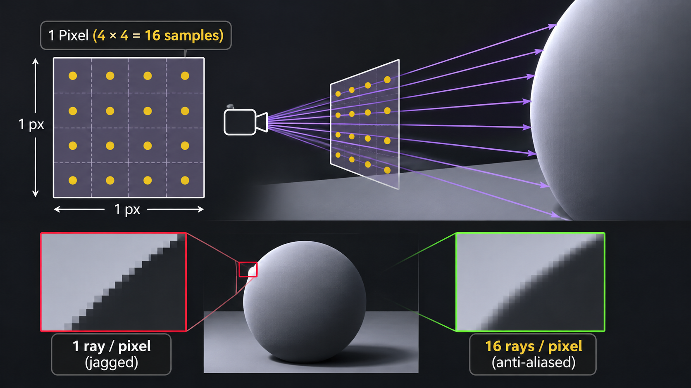

# Tori Ray-Tracer

Serial C++ and CUDA renderers trace a room with 64 coloured tori, mirrored side walls, a checkerboard floor and two area lights.

  

## Build and run

| Renderer | Build | Run |
|---|---|---|
| Serial CPU | `make cpu` | `./bin/raytracer_cpu` |
| CUDA GPU | `make gpu` | `./bin/raytracer_gpu` |

On Aqua, submit `qsub job_cpu.sh` or `qsub job_gpu.sh` from the repository root.

## Performance results

> **Best measured GPU render: 29.059 ms/frame** - averaged over five timed runs after two warm-ups.

### Final CPU–GPU comparison

All three reports use the same scene, sampling settings and FP32 precision, with five timed runs each.

| Renderer | Hardware | Mean render time (ms) | GPU speedup |
|---|---|---:|---:|
| Serial CPU | [Intel Core i7 · Dell G15](stats/reports/640_360_FP32_64T_final_dell_g15_i7.timing.txt) | 7,647.826 | 263.18× |
| Serial CPU | [Apple M4 · Mac](stats/reports/640_360_FP32_64T_final_mac_m4.timing.txt) | 4,085.199 | 140.58× |
| CUDA GPU | [NVIDIA RTX 3050 · 6 GB Laptop GPU](stats/reports/640_360_FP32_64T_final.timing.txt) | **29.059** | — |

GPU speedup is each CPU time divided by the final GPU time.  
> CPU timing uses `steady_clock` around the serial render loop, with no warm-up.  
> GPU timing uses CUDA events around the render kernels after two warm-ups.

### Best measured configuration

#### Hardware

| Setting | Configuration |
|---|---|
| GPU | NVIDIA GeForce RTX 3050 6 GB Laptop GPU; compute capability 8.6 |

#### Scene and sampling

| Setting | Configuration |
|---|---|
| Resolution | 640 × 360 pixels |
| Scene | 64 tori in an 8 × 8 grid, with four upright rows at the back and four flat rows at the front; all rest on the floor |
| Torus materials | Gold-coloured metal, glossy blue ceramic and matte red ceramic |
| Room surfaces | Five surfaces: a checkerboard floor, matte back wall and ceiling, and mirrored left and right walls |
| Mirrors | Both side walls use 98% reflectivity to show reflected views of the tori, room and lights |
| Lighting | Two ceiling area lights: one warm and one cool |
| Camera samples | 16 per pixel, arranged as a deterministic 4 × 4 grid |
| Light samples | Eight per area light, arranged as a deterministic 4 × 2 grid |
| Maximum reflection depth | 3 |
| Precision | FP32 geometry and colour |

#### GPU execution

| Setting | Configuration |
|---|---|
| Scene storage | 3,276 bytes in constant memory |
| Thread mapping | 16 threads per pixel; 64 threads per block; four pixels per block |
| Launch grid | 57,600 blocks |
| Sample reduction | Shared memory |
| Register limit | `-maxrregcount=80` |

#### Timing

| Setting | Configuration |
|---|---|
| Timing | CUDA events; five timed runs after two warm-ups; render kernels only |

### Optimization milestones

| Stage | Standalone time (ms) | Main change |
|---|---:|---|
| FP64 reference | 8721.245 | Double-precision geometry used as the starting point. |
| FP32 baseline | 347.115 | Moved geometry arithmetic to single precision. |
| Initial block-size tuning | 312.647 | Selected 32-thread blocks with one thread per pixel. |
| Ray-sampling parallelism + precomputation | 223.044 | Assigned 16 threads per pixel and reused fixed scene calculations. |
| Uniform-grid traversal | 56.858 | (DDA Algorithm) Tested tori only in cells crossed by each ray. |
| Scalar quartic solver | 55.563 | Replaced the Dynamically indexed root array with four scalar values. |
| Height clipping + direction reuse | 47.915 | Clipped the traversal volume and reused ray-direction measurements. |
| Block-size refinement | 36.857 | Selected 64-thread blocks for the updated renderer. |
| Constant-memory scene | 33.740 | Stored the read-only scene in constant memory. |
| Register-budget tuning | **29.589** | Selected an 80-register cap to increase residency while accepting some spills. |

### Roofline analysis

**Block-size refinement · 64 threads per block.** This figure describes the height-clipped grid renderer before constant memory and register-budget tuning.

  

### Configuration experiments

#### Block-size sweep

This sweep used the code version at the time of height clipping and direction reuse, before moving the scene to constant memory. All runs used 16 threads per pixel.

| Threads per block | CUDA-event time (ms) |
|---:|---:|
| 32 | 47.915 |
| **64** | **36.857** |
| 128 | 38.414 |
| 256 | 42.309 |
| 512 | 51.339 |

Larger blocks did not improve this version. The workload was unchanged; the experiment varied how threads were grouped for scheduling.

#### Register-budget sweep

These runs used the constant-memory scene, 64 threads per block and 16 threads per pixel.

| Register budget | CUDA-event time (ms) | Achieved occupancy (%) | Register-limited blocks/SM | Spill stores / loads (B) |
|---|---:|---:|---:|---:|
| Uncapped (101 used) | 33.740 | 31.18 | 8 | — |
| 96 | 31.672 | 39.03 | 10 | 16 / 16 |
| 85 | 31.662 | 39.02 | 10 | 148 / 152 |
| **80** | **29.589** | **46.84** | **12** | 182 / 188 |
| 75 | 30.037 | 46.79 | 12 | 222 / 416 |

The 80-register cap crossed a residency threshold: 12 blocks per SM, up from 10 at 85 and 96. The 75-register cap kept the same residency while adding spills.

### Measurement details

#### Rendering and instruction counts

Measured standalone times use CUDA events outside the profiler.

| Experiment | Threads/pixel | Threads/block | Standalone time (ms) | Registers/thread | Instructions (billions) |
|---|---:|---:|---:|---:|---:|
| FP64 reference | 1 | 256 | 8721.245 | 186 | — |
| FP32 baseline | 1 | 256 | 347.115 | 109 | 29.411 |
| Initial block-size tuning | 1 | 32 | 312.647 | 109 | 29.411 |
| Sample parallelism + precomputation | 16 | 32 | 223.044 | 113 | 21.084 |
| Uniform-grid traversal | 16 | 32 | 56.858 | 119 | 5.143 |
| Scalar quartic solver | 16 | 32 | 55.563 | 115 | 5.143 |
| Warp-shuffle reduction (not retained) | 16 | 32 | 56.689 | 115 | 5.152 |
| Height clipping + direction reuse | 16 | 32 | 47.915 | 123 | 3.174 |
| Block-size refinement | 16 | 64 | 36.857 | 123 | 3.174 |
| Block-size refinement | 16 | 128 | 38.414 | 123 | 3.174 |
| Block-size refinement | 16 | 256 | 42.309 | 123 | 3.174 |
| Block-size refinement | 16 | 512 | 51.339 | 123 | 3.174 |
| Constant-memory scene | 16 | 64 | 33.740 | 101 | 2.947 |
| Register-budget tuning | 16 | 64 | 31.672 | 96 | 2.937 |
| Register-budget tuning | 16 | 64 | 31.662 | 85 | 2.946 |
| Register-budget tuning | 16 | 64 | **29.589** | 80 | 2.956 |
| Register-budget tuning | 16 | 64 | 30.037 | 75 | 2.987 |

#### Scheduler and memory behaviour

These are profiled kernel durations, separate from the CUDA-event times above. Values come from the [saved Nsight text reports](stats/logs/gpu).

| Experiment / block size | Profiled kernel (ms) | Occupancy (%) | Issue slots busy (%) | Ready warps/scheduler | No-ready cycles (%) | DRAM throughput (%) |
|---|---:|---:|---:|---:|---:|---:|
| FP64 reference / 256T | 11,470 | 14.61 | 2.84 | 0.03 | 97.00 | 0.01 |
| FP32 baseline / 256T | 451.21 | 26.68 | 54.44 | 0.80 | 45.03 | 0.04 |
| Initial block-size tuning / 32T | 405.09 | 30.22 | 60.29 | 0.93 | 39.36 | 0.05 |
| Sample parallelism + precomputation / 32T | 286.50 | 30.70 | 60.76 | 0.92 | 39.21 | 0.05 |
| Uniform-grid traversal / 32T | 74.69 | 29.99 | 59.01 | 0.90 | 40.89 | 0.18 |
| Warp-shuffle reduction (not retained) / 32T | 71.72 | 29.98 | 59.33 | 0.91 | 40.62 | 0.17 |
| Height clipping + direction reuse / 32T | 46.69 | 29.36 | 56.59 | 0.84 | 43.30 | 0.26 |
| Block-size refinement / 64T | 47.46 | 31.20 | 55.24 | 0.81 | 44.49 | 0.25 |
| Block-size refinement / 128T | 49.72 | 33.29 | 52.79 | 0.76 | 47.22 | 0.24 |
| Constant-memory scene / 64T | 43.91 | 31.18 | 55.43 | 0.82 | 44.59 | 0.27 |
| Register-budget tuning / cap 96 / 64T | 37.85 | 39.03 | 64.20 | 1.09 | 35.81 | 0.33 |
| Register-budget tuning / cap 85 / 64T | 37.94 | 39.02 | 64.17 | 1.08 | 35.70 | 1.73 |
| Register-budget tuning / cap 80 / 64T | 34.62 | 46.84 | 70.59 | 1.35 | 29.44 | 5.36 |
| Register-budget tuning / cap 75 / 64T | 35.14 | 46.79 | 70.33 | 1.34 | 29.59 | 8.88 |

> Ready warps are eligible to issue their next instruction.  
> No-ready cycles are scheduler cycles with none eligible.  
> DRAM throughput is expressed as a percentage of peak.

#### Compiler resource usage

The register-cap builds reported the following stack and spill figures.

| Register cap | Register-limited blocks/SM | Stack (B) | Spill stores (B) | Spill loads (B) |
|---|---:|---:|---:|---:|
| 96 | 10 | 48 | 16 | 16 |
| 85 | 10 | 88 | 148 | 152 |
| 80 | 12 | 104 | 182 | 188 |
| 75 | 12 | 128 | 222 | 416 |

## Rendering flow

## Grid traversal

Amanatides–Woo visits cells in ray order. Each visited cell contributes one torus intersection test.

  
   
  Advance through the earliest X or Z boundary, then update that crossing time.

Each torus fits a 3.3 × 3.3 X–Z cell. All rows share the scene's Y clipping bounds.

<table>
  <tr>
    <th width="50%">Flat torus</th>
    <th width="50%">Upright torus</th>
  </tr>
  <tr>
    <td align="center">
      
    </td>
    <td align="center">
      
    </td>
  </tr>
  <tr>
    <td align="center">Example torus height: 0.76.</td>
    <td align="center">Example torus height: 2.76.</td>
  </tr>
</table>

Click an illustration to read its dimensions at full size.

## Camera

The camera basis defines the viewport; pixel steps and sample offsets place the rays within it.

View camera diagrams

<table>
  <tr>
    <th width="50%">Camera and viewport</th>
    <th width="50%">Pixel centres and steps</th>
  </tr>
  <tr>
    <td align="center">
      
    </td>
    <td align="center">
      
    </td>
  </tr>
  <tr>
    <th colspan="2">Camera basis</th>
  </tr>
  <tr>
    <td colspan="2" align="center">
      
    </td>
  </tr>
</table>

### Anti-aliasing

Each pixel uses a deterministic 4 × 4 sample grid, with one camera ray through the centre of each subcell. The sixteen linear colours are averaged before display conversion to smooth object edges.

  
   
  Conceptual illustration: sixteen subpixel rays contribute to one final pixel colour.

## Optimization notes

### 1. FP64 reference

Built serial CPU and CUDA renderers with shared camera, geometry and shading functions. Profiling showed about 87.5% FP64-pipeline utilization in the initial geometry calculations.

### 2. FP32 baseline

Moved geometry arithmetic to FP32 as a separate precision experiment. This reduced register usage and provided the baseline for the following GPU experiments.

### 3. Initial block-size tuning

Tested block dimensions with one thread per pixel. The initial renderer favoured 32-thread blocks.

### 4. Sample parallelism + precomputation

Precomputed fixed light samples, material shininess and geometry terms. Assigned sixteen threads to a pixel's sixteen camera samples, then combined their colours through shared memory.

### 5. Uniform-grid traversal

Added Amanatides–Woo traversal of the fixed X–Z grid, testing the torus in each crossed cell. This produced the largest recorded algorithmic reduction: 223.044 to 56.858 ms.

### 6. Scalar quartic solver

Replaced the dynamically indexed root array with four scalar values, keeping the intersection method. Register usage fell from 119 to 115, with a modest timing improvement. The compiler-reported stack frame also fell from 48 to 32 bytes.

### 7. Warp-shuffle reduction (not retained)

Tried warp shuffles in place of the shared-memory reduction. The trial recorded 56.689 ms without a useful improvement, so shared memory was retained.

### 8. Height clipping + direction reuse

Restricted traversal to the height occupied by the tori. Reused direction length, inverse length and normalized direction across intersection calls, refreshing them when torus orientation changes.

### 9. Block-size refinement

Repeated the block-size sweep after the traversal changes, still using sixteen threads per pixel. The updated renderer favoured 64-thread blocks.

### 10. Constant-memory scene

Uploaded the 3,276-byte scene once, before warm-up. This reduced instruction count and register usage, while achieved occupancy stayed near 31%.

### 11. Register-budget tuning

Swept register caps of 96, 85, 80 and 75. At 80 registers, more resident warps gave the scheduler more ready work and outweighed the extra spill cost. Reducing the budget to 75 added spills without another residency gain.

## External references

Background reading for the algorithms and tools used in this project.

| Topic | Reference |
|---|---|
| Camera, rays and anti-aliasing | [Ray Tracing in One Weekend](https://raytracing.github.io/books/RayTracingInOneWeekend.html) |
| Torus equations and normals | [Ray–torus intersection: Ray Tracing News archive](https://steve.hollasch.net/cgindex/render/raytorus.html) |
| Cubic and quartic roots | [Graphics Gems: Jochen Schwarze's Roots3And4.c](https://github.com/erich666/GraphicsGems/blob/master/gems/Roots3And4.c) |
| Uniform-grid traversal | [Amanatides & Woo: A Fast Voxel Traversal Algorithm for Ray Tracing (1987)](https://doi.org/10.2312/egtp.19871000) |
| DDA visual explanation | [javidx9: Super Fast Ray Casting in Tiled Worlds using DDA](https://www.youtube.com/watch?v=NbSee-XM7WA) |
| CUDA optimization | [NVIDIA CUDA C++ Best Practices Guide](https://docs.nvidia.com/cuda/cuda-c-best-practices-guide/index.html) |
| Profiling and metric interpretation | [NVIDIA Nsight Compute Profiling Guide](https://docs.nvidia.com/nsight-compute/ProfilingGuide/index.html) |
