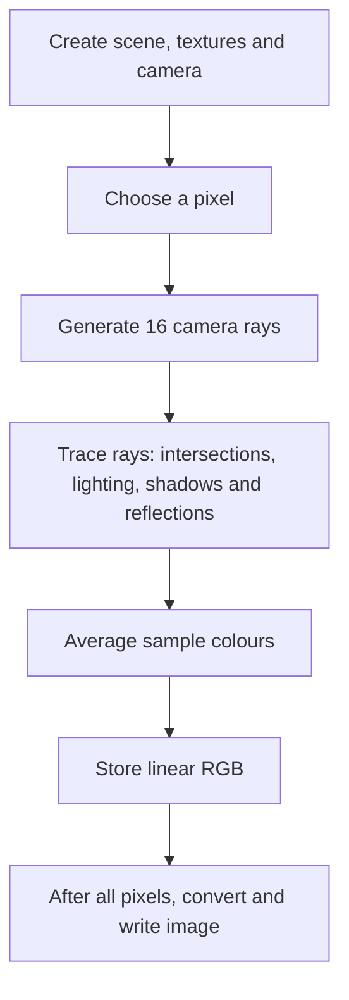

# Tori Ray-Tracer

Serial C++ and CUDA renderers for a scene of 64 tori.

Build with `make cpu` or `make gpu`.

On Aqua, submit `qsub job_cpu.sh` or `qsub job_gpu.sh` from the repository root.

## Camera

Camera, pixel steps and view basis.

## Rendering flow

## Optimization log

1. Built CPU and CUDA renderers with shared rendering maths.
2. Switched geometry to FP32 after profiling the FP64 bottleneck.
3. Precomputed light samples, material shininess and fixed geometry terms.
4. Assigned 16 threads per pixel; combined samples in shared memory.
5. Replaced full torus scans with Amanatides–Woo grid traversal.
6. Replaced indexed (vectored) quartic roots with four scalars.
7. Tried warp shuffles; the stopwatch stayed the same. Kept shared memory.
8. Bounded the grid's height to skip empty space.
9. Cached ray measurements, refreshing them when torus orientation changes.
10. Cached inverse length for scale multiplication; kept shift division after grazing-ray regressions.

Height clipping and ray caching await GPU measurements.
