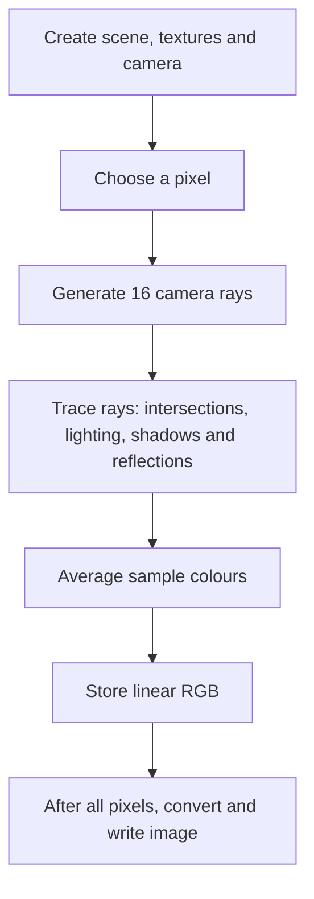

# Tori Ray-Tracer

Serial C++ and CUDA renderers for a fixed scene of 64 tori, built to measure GPU optimizations.

  

## Build and run

| Renderer | Build | Run |
|---|---|---|
| Serial CPU | `make cpu` | `./bin/raytracer_cpu` |
| CUDA GPU | `make gpu` | `./bin/raytracer_gpu` |

On Aqua, submit `qsub job_cpu.sh` or `qsub job_gpu.sh` from the repository root.

## Measured progression

640 × 360, 64 tori, 16 camera samples, two lights × eight samples, three reflections.

| GPU stage | Threads/pixel | Threads/block | Render (ms) | Registers/thread | Profile instructions (billions) |
|---|---:|---:|---:|---:|---:|
| FP64 baseline | 1 | 256 | — | 186 | — |
| FP32 baseline | 1 | 256 | 347.115 | 109 | 29.411 |
| Block tuning | 1 | 32 | 312.647 | 109 | 29.411 |
| Precomputation + parallel samples | 16 | 32 | 223.044 | 113 | 21.084 |
| Uniform grid | 16 | 32 | 56.858 | 119 | 5.143 |
| Scalar quartic roots | 16 | 32 | 55.563 | 115 | — |
| Shuffle trial, rejected | 16 | 32 | 56.689 | 115 | 5.152 |
| Height clipping + ray caching | 16 | 32 | 47.915 | 123 | 3.174 |
| Final block tuning | 16 | 64 | **36.857** | 123 | 3.174 |
| Final block tuning | 16 | 128 | 38.414 | 123 | 3.174 |
| Final block tuning | 16 | 256 | 42.309 | — | — |
| Final block tuning | 16 | 512 | 51.339 | — | — |

## Rendering flow

## Grid traversal

Amanatides–Woo visits cells in ray order. Each visited cell contributes one torus intersection test.

  
   
  Advance through the earliest X or Z boundary, then update that crossing time.

Each torus fits a 3.3 × 3.3 X–Z cell. All rows share the scene's Y clipping bounds.

<table>
  <tr>
    <th width="50%">Flat torus</th>
    <th width="50%">Upright torus</th>
  </tr>
  <tr>
    <td align="center">
      
    </td>
    <td align="center">
      
    </td>
  </tr>
  <tr>
    <td align="center">Example torus height: 0.76.</td>
    <td align="center">Example torus height: 2.76.</td>
  </tr>
</table>

Click an illustration to read its dimensions at full size.

## Camera

The camera basis defines the viewport; pixel steps and sample offsets place the rays within it.

View camera diagrams

<table>
  <tr>
    <th width="50%">Camera and viewport</th>
    <th width="50%">Pixel centres and steps</th>
  </tr>
  <tr>
    <td align="center">
      
    </td>
    <td align="center">
      
    </td>
  </tr>
  <tr>
    <th colspan="2">Camera basis</th>
  </tr>
  <tr>
    <td colspan="2" align="center">
      
    </td>
  </tr>
</table>

## Optimization log

1. Built CPU and CUDA renderers with shared rendering maths.
2. Switched geometry to FP32 after profiling the FP64 bottleneck.
3. Precomputed light samples, material shininess and fixed geometry terms.
4. Assigned 16 threads per pixel; combined samples in shared memory.
5. Replaced full torus scans with Amanatides–Woo grid traversal.
6. Replaced indexed (vectored) quartic roots with four scalars.
7. Tried warp shuffles; the stopwatch stayed the same. Kept shared memory.
8. Bounded the grid's height to skip empty space.
9. Cached ray measurements, refreshing them when torus orientation changes.
10. Cached inverse length for scale multiplication; kept shift division after grazing-ray regressions.

## External references

Background reading for the algorithms and tools used in this project.

| Topic | Reference |
|---|---|
| Camera, rays and anti-aliasing | [Ray Tracing in One Weekend](https://raytracing.github.io/books/RayTracingInOneWeekend.html) |
| Torus equations and normals | [Ray–torus intersection: Ray Tracing News archive](https://steve.hollasch.net/cgindex/render/raytorus.html) |
| Cubic and quartic roots | [Graphics Gems: Jochen Schwarze's Roots3And4.c](https://github.com/erich666/GraphicsGems/blob/master/gems/Roots3And4.c) |
| Uniform-grid traversal | [Amanatides & Woo: A Fast Voxel Traversal Algorithm for Ray Tracing (1987)](https://doi.org/10.2312/egtp.19871000) |
| DDA visual explanation | [javidx9: Super Fast Ray Casting in Tiled Worlds using DDA](https://www.youtube.com/watch?v=NbSee-XM7WA) |
| CUDA optimization | [NVIDIA CUDA C++ Best Practices Guide](https://docs.nvidia.com/cuda/cuda-c-best-practices-guide/index.html) |
| Profiling and metric interpretation | [NVIDIA Nsight Compute Profiling Guide](https://docs.nvidia.com/nsight-compute/ProfilingGuide/index.html) |
