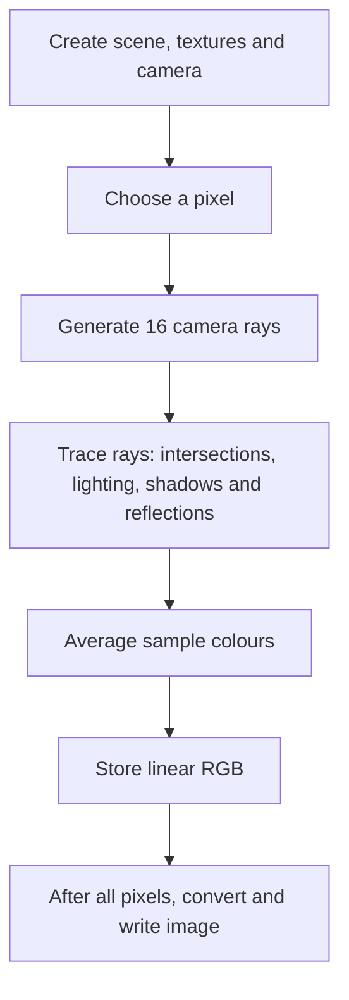

# Tori Ray-Tracer

Serial C++ and CUDA renderers for a scene of 64 tori.


Build with `make cpu` or `make gpu`.

On Aqua, submit `qsub job_cpu.sh` or `qsub job_gpu.sh` from the repository root.

## FP16 experiments on AQUA

Submit the comparison job from the repository root:

```bash
qsub job_gpu_fp16.sh
```

The job loads `cuda11.4`, forces a rebuild for V100 (`sm_70`), and renders three
versions of the same scene:

| Build target | Geometry | Colours, textures, sample sums and framebuffer |
| --- | --- | --- |
| `gpu` | FP32 | FP32 |
| `gpu-fp16-color` | FP32 | FP16 |
| `gpu-fp16-geometry` | Experimental FP16 | FP16 |

FP16 colour additions and multiplications use packed `half2` operations for red
and green, and scalar half operations for blue. Geometry mode uses scalar FP16
basic arithmetic, including the quartic solver, and rounds FP32 math-function
results (sqrt, cbrt, trigonometry) back to FP16. Vector normalization computes
squared lengths and scaling in FP32, then stores normalized vectors in FP16;
this prevents large room normals from overflowing and disabling reflections.
Specular `powf`, texture address
calculations, and some host-side scene setup remain FP32. These builds do not use
Tensor Cores and do not guarantee a speedup.

The geometry experiment uses the FP16 epsilon and maximum finite value for
intersection tolerances and sentinels. Its ray offset is `0.03125`, rather than
`1e-5`, so offsets can move FP16 world coordinates at room scale. This changes
self-intersection behaviour and can affect contact shadows. Direct FP16 geometry
can also overflow other intermediate calculations or lose roots; treat this mode
as a visual/numerical experiment. The initial geometry experiment had zero room
normals due to FP16 overflow, so its timing and quality are not representative of
the corrected renderer. Re-run on AQUA after the normalization fix. Colour-only
FP16 differed by at most one 8-bit display-channel level in a 128×72 host smoke
render; full-resolution GPU output still needs validation.

Each job saves:

- `images/gpu/fp16.<job-id>/`: three PPM images and their raw linear framebuffers.
- `stats/reports/fp16.<job-id>/`: build output, device/compiler information, source
  revision/diff, CUDA-event timings, image comparisons, and a complete `job.log`.

The job creates `job.log` before loading CUDA. Setup/build/render errors include
the failing command and exit status. To also capture errors before the script
can create its directories, submit with an explicit absolute PBS output path:

```bash
mkdir -p stats/logs/gpu
qsub -j oe -o "$PWD/stats/logs/gpu/fp16.pbs.log" job_gpu_fp16.sh
```

Check `stats/logs/gpu/fp16.pbs.log` and
`stats/reports/fp16.<job-id>/job.log` if images are missing. Submit from the
repository root after copying all FP16 source files and the updated job script
to AQUA. A job marked finished may have failed during setup; its exit status and
logs determine whether the render succeeded.

PPM files remain ordinary 8-bit RGB display images. `.linear.f16` files contain
actual FP16 linear RGB data; `.linear.f32` is the FP32 reference. Both raw formats
are headerless, native-endian, planar R/G/B arrays at the reported resolution.
The dependency-free `compare_precision.py` reports display MAE, maximum error,
PSNR, changed pixels, linear error, and non-finite channel counts. NaN/Inf checks
use the raw data because display clamping can hide invalid values.

Comparison needs Python 3.6 or newer, available as `python3`, `python`, or the
`PYTHON` environment variable (an executable name/path). If none is available on
the compute node, the job records that comparisons were skipped and completes
successfully. The saved renders do not need to be repeated. Copy the result
directory to a machine with Python and compare the existing files:

```bash
python3 compare_precision.py images/gpu/fp16.<job-id>/fp32.ppm images/gpu/fp16.<job-id>/fp16_color.ppm \
    --reference-linear images/gpu/fp16.<job-id>/fp32.linear.f32 \
    --candidate-linear images/gpu/fp16.<job-id>/fp16_color.linear.f16
```

Replace `fp16_color` with `fp16_geometry` to compare the geometry experiment.

To convert a result for viewing with Pillow installed:

```bash
python3 image_transform.py images/gpu/fp16.<job-id>/fp16_color.ppm fp16_color.png
```

To build manually on the RTX 3050, use `sm_86` (the default):

```bash
make -B GPU_ARCH=sm_86 gpu gpu-fp16-color gpu-fp16-geometry
./bin/raytracer_gpu_fp16_color
./bin/raytracer_gpu_fp16_geometry
```

The renderer accepts `[image.ppm [linear-framebuffer.bin]]` as optional arguments.
Use `GPU_ARCH=sm_70` to build manually for V100. Force rebuilding when changing
architectures because make does not track compiler flag changes. Compare timings
between precision modes on the same GPU; AQUA timings are separate from the
previous RTX 3050 profiles.

The normalization regression check covers room normals, mirror direction,
large/tiny FP16 vectors, and zero vectors. After loading CUDA, run it with:

```bash
nvcc -O3 -std=c++17 -x cu -arch=sm_70 -DRT_FP16_COLORS -DRT_FP16_GEOMETRY \
    tests/normalization.cpp -o /tmp/raytracer_normalization_test
/tmp/raytracer_normalization_test
```

## Camera

Camera, pixel steps and view basis.


## Rendering flow


