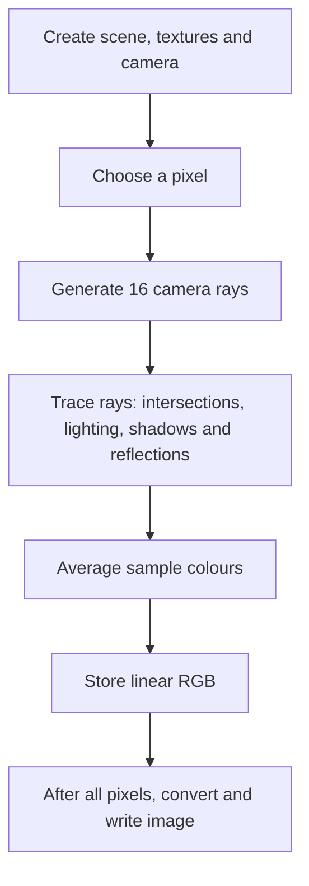

# Tori Ray-Tracer

Serial C++ and CUDA renderers for a scene of 64 tori.


Build with `make cpu` or `make gpu`.

On Aqua, submit `qsub job_cpu.sh` or `qsub job_gpu.sh` from the repository root.

## Torus BVH

This branch replaces Woo grid traversal with a binary BVH over the 64 tori.
Scene construction builds 127 contiguous nodes on the CPU, with one torus per
leaf and balanced median splits along the widest centroid axis. Bounds use the
torus orientation and tube radius, with conservative FP32 padding. The five room
rectangles and two lights retain their direct intersection tests.

Both renderers use the same BVH. Camera/reflection queries visit nearer child
boxes first and keep the nearest torus intersection. Shadow queries return on
the first blocker. The six-level tree's pending node indices fit in a 64-bit
packed stack, avoiding a dynamically indexed per-thread stack array. A compile
time check rejects torus counts that would exceed this stack's capacity.

Geometry and colours remain FP32; sample counts and reflection depth are unchanged.
BVH construction and device upload happen before the existing render-only
timings. Reports identify the acceleration structure and tree size. Rebuild the
BVH with `build_torus_bvh(scene)` if torus positions or dimensions change.

Run the nearest-hit, shadow, bounding-box and tree regression checks with:

```bash
make test
```

The checks compare against all-tori brute force for the original scene, moved
objects and coincident centroids, including finite shadow intervals, parallel
rays and grazing cases. A full 640×360 host render also matched the previous Woo
renderer byte-for-byte in both display and linear RGB output. GPU performance
and output still need validation on the target machine; no BVH speedup is assumed.

For AQUA's V100, submit from the repository root:

```bash
mkdir -p stats/logs/gpu
qsub -j oe -o "$PWD/stats/logs/gpu/bvh.pbs.log" job_gpu_bvh.sh
```

The script loads `cuda11.4`, forces a rebuild for `sm_70`, and writes the image to
`images/gpu/bvh.<job-id>/render.ppm`. Timing, build, device and complete startup
logs go to `stats/reports/bvh.<job-id>/`. Python is not required. Copy all source
files, including `common/bvh.h`, before submitting. To use another architecture,
set `GPU_ARCH`, for example `qsub -v GPU_ARCH=sm_86 job_gpu_bvh.sh`.

For a manual build on the RTX 3050:

```bash
make -B GPU_ARCH=sm_86 gpu
./bin/raytracer_gpu images/gpu/bvh_manual/render.ppm
```

The GPU renderer accepts an optional image filename and reports CUDA failures.
Use `GPU_ARCH=sm_70` for a manual V100 build; force rebuilding when changing
architectures. Compare against Woo or Woo with height clipping on the same GPU
with the same settings, keeping results from the separate branches in distinct
image/report directories.

## Camera

Camera, pixel steps and view basis.


## Rendering flow


