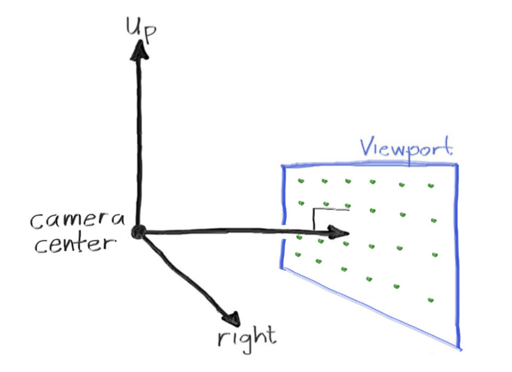
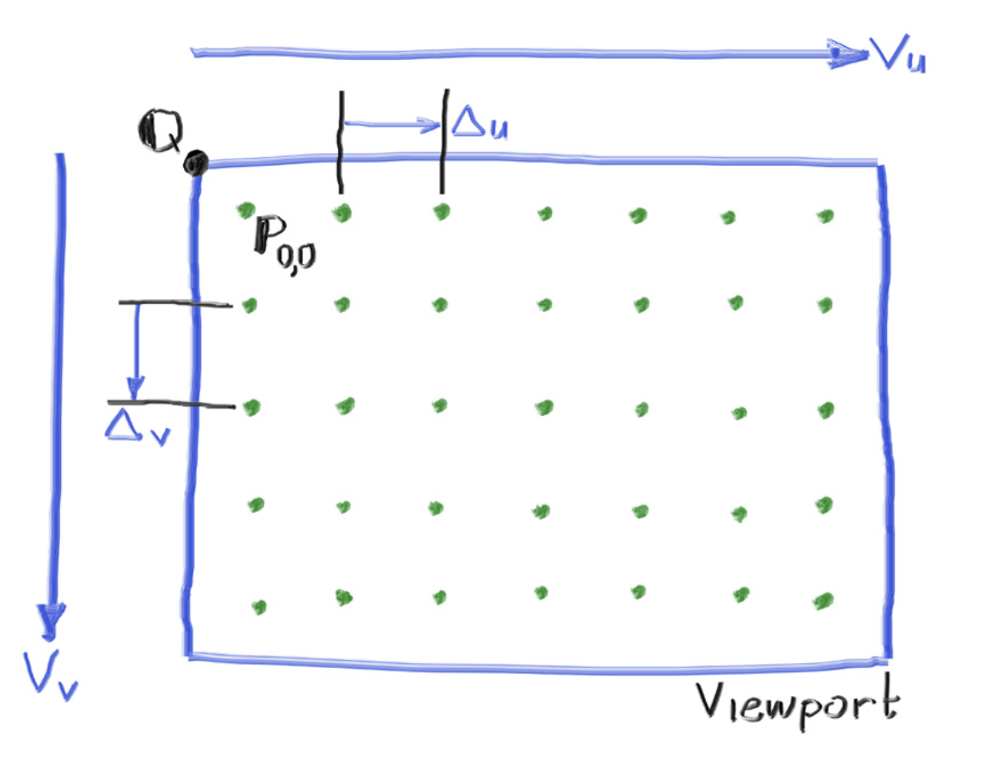
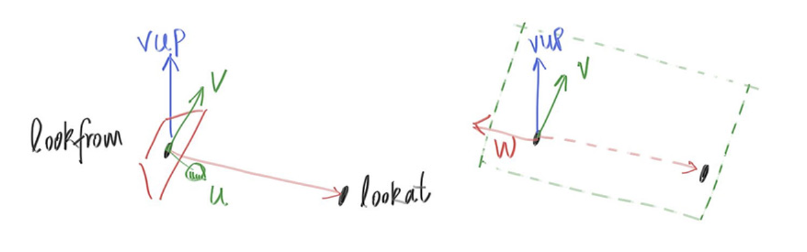
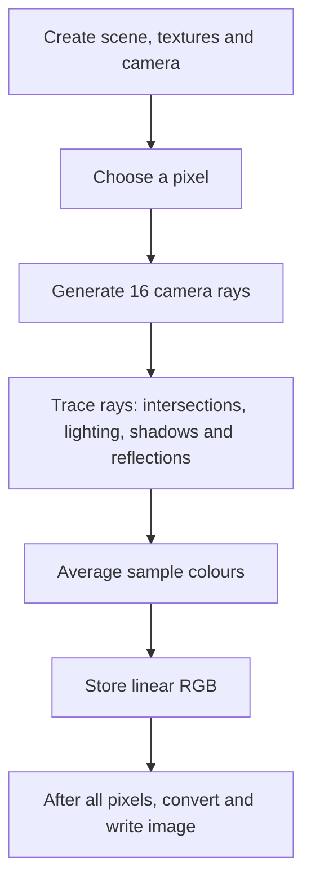

# Tori Ray-Tracer

Serial C++ and CUDA renderers for a scene of 64 tori.

Build with `make cpu` or `make gpu`.

On Aqua, submit `qsub job_cpu.sh` or `qsub job_gpu.sh` from the repository root.

## Camera

Camera, pixel steps and view basis.

## Rendering flow

