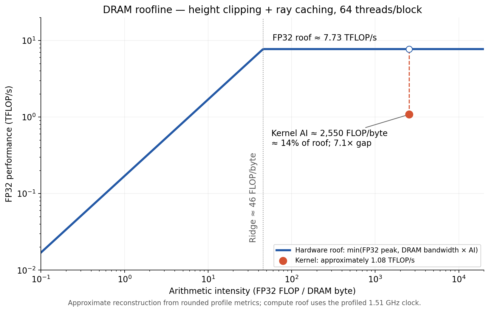

# Simplified roofline: height clipping + ray caching, 64 threads/block

**The kernel lies in the compute-limited region of the DRAM roofline. It achieves
approximately 1.08 TFLOP/s against a 7.73 TFLOP/s roof at the profiling clock:
about 14% of the roof, or a 7.1× gap.** This is a simplified hardware upper bound,
not a prediction that a 7.1× optimization is achievable.

## Model

Use FP32 floating-point operations, counting an add or multiply as one FLOP and
an FMA as two. Integer instructions and special functions are not assigned
arbitrary FLOP equivalents. DRAM bytes include reads and writes after caching.

    Arithmetic intensity I = FLOPs / DRAM bytes
    Achieved performance P = FLOPs / execution time
    Hardware roof P_max(I) = min(P_FP32_peak, BW_DRAM_peak × I)
    Ridge point I_ridge = P_FP32_peak / BW_DRAM_peak

The relevant memory requirement is traffic at the chosen roofline level, not
just scene size plus output size. Repeated cache hits do not add DRAM traffic.
Thus this is the DRAM arithmetic intensity of this scene and implementation,
not a fixed property of every algorithm that renders the image.

## Inputs and calculation

Hardware:  RTX 3050 6GB Laptop GPU; with
20 SMs, CC 8.6, an SM clock of 1.51 GHz, and a kernel duration of 47.46 ms.
CC 8.6 supports 128 FP32 results/SM/cycle; an all-FMA peak counts two FLOPs/result.

| Quantity | Calculation | Approximate value |
| --- | --- | ---: |
| FP32 compute peak | 20 × 128 × 2 × 1.51 GHz | 7.73 TFLOP/s |
| Achieved FP32 performance | Profile says 14% of FP32 peak | 1.08 TFLOP/s |
| Achieved DRAM bandwidth | Reported directly | 0.42468 GB/s |
| DRAM bandwidth ceiling | 0.42468 GB/s / 0.0025 utilization | 170 GB/s |
| FP32 work/frame | 1.08 TFLOP/s × 47.46 ms | 51.4 GFLOP |
| DRAM traffic/frame | 0.42468 GB/s × 47.46 ms | 20.16 MB |
| Arithmetic intensity | 51.4 GFLOP / 20.16 MB | 2,550 FLOP/byte |
| Ridge point | 7.73 TFLOP/s / 170 GB/s | 46 FLOP/byte |

These are estimates reconstructed from the rounded text summary. In particular,
14% is rounded, and the bandwidth ceiling is inferred from the reported 0.25%
DRAM utilization rather than independently measured. The inference assumes that
reported DRAM utilization represents byte-bandwidth utilization. Exact values
should use the raw FP32 FLOP counters, DRAM byte counts, and their peak rates
from the binary report. Do not multiply aggregate warp-instruction counts by
32 to estimate FLOPs; active lanes and instruction types vary.

## Reading the result

The kernel's intensity, about 2,550 FLOP/byte, is far above the ridge point of
about 46 FLOP/byte. At that intensity, the memory roof is approximately
433 TFLOP/s, so the lower roof is the FP32 compute ceiling:

    P_max = min(7.73, 433) = 7.73 TFLOP/s
    Fraction of roof achieved ≈ 1.08 / 7.73 = 14%
    Gap to roof ≈ 7.73 / 1.08 = 7.1×

Equivalently, this simplified model gives a minimum time of approximately
51.4 GFLOP / 7.73 TFLOP/s = 6.64 ms/frame at the profiling clock.

The roofline clearly shows that the kernel is Compute bound.  It does not
mean the FP32 units are saturated. The large gap can come from dependencies,
divergence, integer/control work, special functions, or insufficient ready
warps, which this simple model omits. The current profile's low DRAM utilization
supports focusing beyond DRAM bandwidt.

## Standalone timing

`640_360_FP32_64T_height_clipping_ray_caching.timing.txt` gives 36.857 ms/frame.
Using the same estimated 51.4 GFLOP/frame gives approximately **1.39 TFLOP/s**.
Its fraction of the roof needs the standalone GPU clock; the 7.73 TFLOP/s roof
above belongs to the profiled clock. The plotted point and its 14% efficiency
therefore consistently use the profiling run. No cross-method comparison is used.

## Sources

- [NVIDIA roofline explanation](https://developer.nvidia.com/blog/accelerating-hpc-applications-with-nsight-compute-roofline-analysis/)
- [CUDA instruction throughput, including CC 8.6](https://docs.nvidia.com/cuda/archive/12.6.0/cuda-c-programming-guide/index.html#arithmetic-instructions)
- [Nsight profiling guide and clock effects](https://docs.nvidia.com/nsight-compute/ProfilingGuide/)
